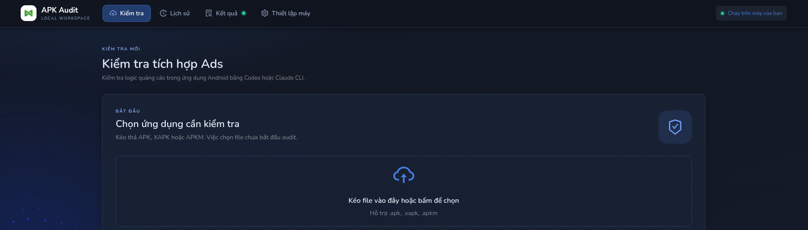

# APK Audit

Kiểm tra tự động cách một app Android tích hợp quảng cáo Infinity:

- **ID quảng cáo** trong app có khớp ADS SCRIPTS không.
- **4 màn đầu** (Splash, Language, Onboarding, Welcome) tải và hiện quảng cáo có đúng yêu cầu không.
- **Cấu hình**: Remote Config, cờ bật/tắt, mediation, ID test ở bản debug…

Tool chạy **trên máy của bạn**. APK, tài liệu và kết quả không rời khỏi máy; chỉ đoạn code cần kiểm được gửi tới AI (Claude hoặc Codex) bằng tài khoản của bạn.



## Cài đặt (một lần)

1. Tải file **`apk-audit-x.y.z.zip`** ở trang [Releases](https://github.com/NguyenMinhVu02/Tool-Auto-Check-Ads/releases/latest), giải nén vào một thư mục cố định (ví dụ Documents). **Không di chuyển thư mục này sau khi cài.**
2. Mở thư mục `installer/`, bấm đúp file theo máy:

   | Máy | File | Nếu bị chặn |
   |---|---|---|
   | Windows | `Cai-dat-Windows.bat` | *More info* → *Run anyway* |
   | macOS | `Cai-dat-macOS.command` | Chuột phải → *Open* → *Open* |
   | Linux | `cai-dat-linux.sh` | Chuột phải → *Run as a Program* |

3. Chờ 1–3 phút. Tool tạo biểu tượng **APK Audit** trên màn hình chính và tự mở trang web.
4. Trên web, vào **Thiết lập máy**: bấm **Cài tất cả phần bắt buộc** (Java, JADX), rồi cài và **Đăng nhập** Claude CLI hoặc Codex CLI. Không cần quyền quản trị.

## Dùng hằng ngày

1. Bấm biểu tượng **APK Audit**. Giữ cửa sổ nhỏ hiện ra; đóng nó là tắt tool.
2. Tab **Kiểm tra**: kéo file APK / XAPK / APKM vào.
3. Chọn **ADS SCRIPTS** và **working file** của đúng app đó (nên dùng XLSX).
4. Bấm **Bắt đầu kiểm tra**. Mỗi lượt mất vài phút; xong tự chuyển sang tab **Kết quả**.

## Đọc kết quả

| Ký hiệu | Ý nghĩa |
|---|---|
| ✅ Đạt | Đúng yêu cầu, có bằng chứng trong code |
| ❌ Cần sửa | Sai yêu cầu, kèm vị trí code để báo dev |
| ❔ Cần dev xem lại | Chưa đủ căn cứ. **Không có nghĩa app lỗi** |
| ➖ Không áp dụng | Tài liệu xác định không dùng phần này |

- **Tab Tester**: ID sai/thiếu theo từng màn và logic từng màn. Có nút **Copy cho Google Sheet** (dán thẳng vào bảng bug đối tác), **Copy tóm tắt gửi đối tác**, **Tải CSV**, **Báo cáo HTML**.
- **Tab Dev**: kết luận từng rule, việc cần sửa, vị trí `file:dòng`, bằng chứng.

> Kết quả dựa trên **đọc code**, chưa chạy app thật. Kết quả ❌ nên được dev xác nhận trước khi sửa.

## Tool kiểm tra gì

| Nhóm | Nội dung | Cách kiểm |
|---|---|---|
| 4 màn đầu | Tải, hiện, preload, xử lý lỗi / offline / hết thời gian | AI đọc code |
| Khởi tạo | Init SDK, Remote Config và fallback, nguồn ID | AI đọc code |
| ID ads | ID tài liệu so với `ad_config.json`; bản debug phải dùng ID test | Tự động, không tốn token |
| Cấu hình | `isEnable`, `enable_ua_check`, key Remote Config, khoảng cách inter 35 giây | Tự động |
| Màn hình | Tên 4 Activity, chặn xoay màn hình, Dev setting ở màn Language | Tự động |
| Mediation | Mỗi mạng (AppLovin, Mintegral, Pangle, Meta…) có đủ adapter và SDK | Tự động |
| Uninstall | Shortcut Uninstall, màn Confirm Uninstall và Survey, vị trí native của hai màn | Tự động |
| Khác | Chữ "This action may contain ads" ở Splash; thời gian chờ nút Done ở Language (chỉ để tham khảo) | Tự động |

Hai tùy chọn trên trang Kiểm tra (mặc định tắt, tốn thêm token): **Kiểm đầy đủ cho dev** (thêm Load/observe và Banner) và **Rà lỗi chéo giữa các luồng**.

## Cập nhật

Web tự kiểm tra bản mới khi mở. Có bản mới thì hiện thông báo, bấm **Cập nhật** là xong; tool tự khởi động lại và giữ nguyên kết quả cũ. Kiểm tra tay: **Thiết lập máy → Cập nhật tool → Kiểm tra cập nhật**.

## Lưu ý

- Tool **tự chọn model AI** tiết kiệm và phù hợp (Claude Sonnet mới nhất, hoặc Codex Terra mới nhất; mức suy nghĩ low). Máy chỉ có một AI CLI thì dùng luôn cái đó.
- Mỗi lượt kiểm tra dùng hạn mức gói AI của bạn. Chạy lại cùng APK hoặc bản build mới có code không đổi sẽ dùng lại kết quả cũ, rẻ hơn nhiều.
- ADS SCRIPTS và working file phải **cùng một app**; nếu lệch, tool dừng và hỏi trước khi tốn hạn mức AI.
- APK bị làm rối (R8) có thể ra nhiều ❔ hơn: tool không kết luận lỗi chỉ vì không thấy tên hàm.

## Lỗi thường gặp

| Hiện tượng | Cách xử lý |
|---|---|
| Thiết lập máy báo thiếu công cụ | Bấm **Cài** ở dòng đó; lỗi mạng thì bấm lại |
| Rule ra ❔ "AI hết hạn mức" | Chờ hạn mức làm mới rồi chạy lại; phần đã xong được giữ |
| AI báo chưa đăng nhập | Thiết lập máy → **Đăng nhập** ở dòng Claude / Codex |
| Trang không mở | Đóng cửa sổ APK Audit, bấm lại biểu tượng |
| Biểu tượng mất hoặc hỏng | Chạy lại file cài trong `installer/` |

---

## Dành cho dev

```bash
uv sync --extra mcp                       # cài phụ thuộc
uv run apk-audit serve --open             # web http://127.0.0.1:8765
uv run apk-audit doctor                   # kiểm tra công cụ
uv run apk-audit audit app.apk --ads-scripts ADS.xlsx --checklist working.xlsx
uv run apk-audit audit app.apk --engine none   # chỉ rule tự động, không tốn token
uv run --extra mcp python -m unittest discover -s tests
cd frontend && npm ci && npm run build    # build giao diện vào apk_audit/web_assets
```

- Tùy chọn CLI hay dùng: `--engine claude|codex|none`, `--workers 1-10`, `--full`, `--cross-flow`, `--only RULE_ID`. Mã thoát `1` = có rule ❌, `7` = tài liệu có vẻ thuộc app khác (`--confirm-mismatch` để bỏ qua).
- Ép model: `APK_AUDIT_CLAUDE_MODEL=haiku`, `APK_AUDIT_CODEX_MODEL=<tên>`.
- Rule nằm ở `rulepacks/default/rules/` (YAML); kiểm tra bằng `uv run apk-audit rules check`.
- **Phát hành bản mới:** nâng `version` trong `pyproject.toml` → commit vào `main` → `git tag vX.Y.Z && git push origin vX.Y.Z`. GitHub Actions chạy test, đóng gói ZIP và tạo Release; máy người dùng sẽ thấy thông báo cập nhật. Ghi chú phát hành lấy từ `docs/releases/vX.Y.Z.md` nếu có.
- Tài liệu: [Tham chiếu kỹ thuật](docs/technical-reference.md) · [Chuẩn ads/init của base](docs/base-ads-contract.md) · [Tối ưu và kiểm chứng](docs/audit-optimization.md) · Nhật ký: [`SESSION_LOG.md`](SESSION_LOG.md)
